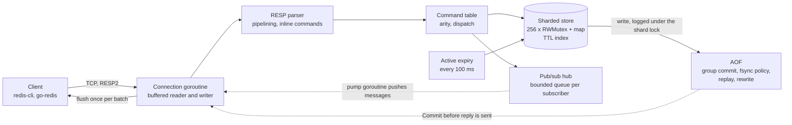

# Ember

[](https://github.com/bipaulr/ember/actions/workflows/ci.yml)

A Redis-compatible in-memory key-value server written in Go with only the
standard library. The real `redis-cli`, `redis-benchmark` and `go-redis` talk to
it unchanged. It runs as a single node with an append-only file, or as a
replicated cluster where every write goes through a Raft log
([cluster mode](#cluster-mode-raft)).

## Architecture



## Quickstart

With Docker:

```bash
docker build -t ember .
docker run --rm -p 6380:6380 -v ember-data:/data ember
```

or with Go 1.25 or newer:

```bash
go run ./cmd/ember --port 6380
```

then, in another terminal (any `redis-cli` works; `docker` shown for convenience,
use `host.docker.internal` on Windows and macOS, or `--network host` on Linux):

```bash
docker run --rm -it redis:7-alpine redis-cli -h host.docker.internal -p 6380
127.0.0.1:6380> SET greeting "hello world" EX 60
OK
127.0.0.1:6380> GET greeting
"hello world"
127.0.0.1:6380> TTL greeting
(integer) 59
```

[docs/transcript.txt](docs/transcript.txt) is a recorded session of 72 commands, every
supported command included, run through the real `redis-cli` (7.4) against the container.

The default port is 6380 so Ember can run next to a real Redis on 6379. Data is
written to `ember.aof` in the working directory (`/data/ember.aof` in the
image); pass `--aof-path ""` to run without persistence.

### Flags

| Flag | Default | Meaning |
|---|---|---|
| `--host` | `0.0.0.0` | interface to listen on |
| `--port` | `6380` | TCP port |
| `--aof-path` | `ember.aof` | append-only file; empty disables persistence |
| `--appendfsync` | `everysec` | `always`, `everysec` or `no` |
| `--shards` | `256` | keyspace shards |
| `--max-clients` | `10000` | connection limit |
| `--aof-rewrite-min-size` | `67108864` | automatic rewrite threshold in bytes (negative disables) |
| `--node-id` | `0` | this node's id in `--cluster`; `0` runs a single node |
| `--cluster` | | every member as `id=raft-host:port/client-host:port`, comma separated |
| `--election-timeout` | `300ms` | cluster: shortest wait without a leader before an election |
| `--heartbeat-interval` | `50ms` | cluster: how often the leader contacts each follower |
| `--pprof-addr` | off | serve `net/http/pprof`, e.g. `127.0.0.1:6060` |
| `--healthcheck` | | connect to the local server, `PING`, exit 0 on `PONG` (used by the Docker `HEALTHCHECK`) |
| `--verbose` | off | debug logging |

**In a container with a CPU limit, set `GOMAXPROCS` to the limit**
(`docker run --cpus 2 -e GOMAXPROCS=2 ...`). Go 1.25 reads the limit but never goes
below 2, and a mismatch makes the kernel throttle the process, which cost a 4x
throughput loss and a 67 ms p99 in my benchmarks (see docs/BENCHMARKS.md).

Ctrl+C or SIGTERM triggers a graceful shutdown: stop accepting, let running
commands finish, flush and fsync the AOF, exit.

## Cluster mode (Raft)

Start every node with the same `--cluster` list and its own `--node-id`. Three
nodes on one machine:

```bash
CLUSTER=1=127.0.0.1:7001/127.0.0.1:6381,2=127.0.0.1:7002/127.0.0.1:6382,3=127.0.0.1:7003/127.0.0.1:6383
go run ./cmd/ember --node-id 1 --port 6381 --cluster $CLUSTER
go run ./cmd/ember --node-id 2 --port 6382 --cluster $CLUSTER
go run ./cmd/ember --node-id 3 --port 6383 --cluster $CLUSTER
```

How it behaves:

* The nodes elect a leader with Raft (randomized election timeouts, heartbeats).
  Nodes talk to each other over TCP with the standard library's `net/rpc`.
* A write command is not run directly. The leader appends it to the Raft log,
  replicates it, and replies only after a majority of nodes has the entry and it
  has been applied. Every node applies the same commands in the same order.
* A write sent to a follower gets `-MOVED 0 <leader-host:port>`, so
  `redis-cli -c` follows it to the leader. With no known leader the reply is
  `-CLUSTERDOWN`, and the client should retry.
* The leader puts its clock reading into each entry and expiry runs on that log
  clock, so TTLs expire at the same point on every node.
* Reads are answered by whichever node receives them, so a follower can return
  a value that is slightly behind the leader.
* `INFO cluster` shows this node's role, term, leader, and log and commit
  indexes.

Limits: the Raft log and term are kept in memory only, and the AOF is turned off
in cluster mode, so the data survives losing a minority of nodes but not
restarting the whole cluster. There are no log snapshots or membership changes
(the member list is fixed at startup), and `PUBLISH` reaches subscribers on the
receiving node only.

## Supported commands

| Group | Commands |
|---|---|
| Connection | `PING` `ECHO` `QUIT` `SELECT` (database 0 only) `HELLO` (RESP2 only) `CLIENT` (`ID` `SETNAME` `GETNAME` `SETINFO`) |
| Strings | `SET` (`EX` `PX` `EXAT` `PXAT` `NX` `XX` `GET` `KEEPTTL`) `GET` `GETDEL` `MSET` `MGET` `INCR` `DECR` `INCRBY` `DECRBY` `APPEND` `STRLEN` |
| Keys | `DEL` `EXISTS` `EXPIRE` `PEXPIRE` `EXPIREAT` `PEXPIREAT` (with `NX` `XX` `GT` `LT`) `TTL` `PTTL` `PERSIST` `TYPE` `KEYS` (glob) `DBSIZE` `FLUSHALL` `FLUSHDB` |
| Lists | `LPUSH` `RPUSH` `LPOP` `RPOP` (optional count) `LLEN` `LRANGE` |
| Pub/sub | `SUBSCRIBE` `UNSUBSCRIBE` `PSUBSCRIBE` `PUNSUBSCRIBE` `PUBLISH` `PUBSUB` (`CHANNELS` `NUMSUB` `NUMPAT`) |
| Server | `INFO` (`server` `clients` `stats` `persistence` `cluster` `keyspace`) `COMMAND` (`COUNT` `DOCS` `INFO` `LIST`) `CONFIG GET` `BGREWRITEAOF` |

Error replies use Redis's wording, for example
`-WRONGTYPE Operation against a key holding the wrong kind of value`,
`-ERR wrong number of arguments for 'get' command` and
`-ERR value is not an integer or out of range`.

## Not supported

Redis Cluster (hash slots and the `CLUSTER` commands), Redis-style primary/replica
replication (`REPLICAOF`), RESP3 (`HELLO 3` is refused with `NOPROTO`),
transactions (`MULTI`/`EXEC`), Lua scripting, RDB snapshots, eviction policies
and `maxmemory`, hashes, sets, sorted sets, streams, ACLs and TLS. Only database
0 exists. Multi-key commands (`MSET`, `DEL a b`) are not atomic across keys.

## Benchmarks

Ember against Redis 7.4 in Docker on one network, same CPU and memory limits,
both with AOF `everysec`, 50 clients, 100,000 requests, pipeline depths 1 and 16:

**2 CPUs each, 1,000,000 requests per cell** (the specified 100,000-request run is in BENCHMARKS.md; at that size `redis-benchmark`'s timer resolution hides the fast cases):

Median of 3 runs. rps is requests per second; latencies are milliseconds.

| Test | -P | Redis rps | Ember rps | Ember / Redis | Redis p50 | Ember p50 | Redis p99 | Ember p99 | rps range (Redis; Ember) |
|---|---:|---:|---:|---:|---:|---:|---:|---:|---|
| SET | 1 | 68942 | 88834 | 1.29x | 0.687 | 0.391 | 1.279 | 1.863 | 68932 to 68942; 88786 to 121197 |
| GET | 1 | 74069 | 128999 | 1.74x | 0.631 | 0.287 | 1.183 | 1.343 | 70102 to 75472; 111099 to 153870 |
| INCR | 1 | 70151 | 105219 | 1.50x | 0.671 | 0.367 | 1.247 | 1.607 | 53276 to 71398; 99980 to 117619 |
| LPUSH | 1 | 65535 | 121183 | 1.85x | 0.719 | 0.335 | 1.359 | 1.239 | 54010 to 65544; 90868 to 125000 |
| SET | 16 | 362976 | 665779 | 1.83x | 2.007 | 0.847 | 3.839 | 4.679 | 332668 to 362976; 499002 to 666222 |
| GET | 16 | 570451 | 1333333 | 2.34x | 1.143 | 0.311 | 2.007 | 1.255 | 570451 to 666222; 999001 to 1333333 |
| INCR | 16 | 399361 | 666222 | 1.67x | 1.679 | 0.903 | 3.383 | 5.263 | 399202 to 399680; 570776 to 666222 |
| LPUSH | 16 | 266099 | 665779 | 2.50x | 2.815 | 0.623 | 5.399 | 4.903 | 249377 to 266170; 570776 to 666222 |

Per core the picture changes: **with 1 CPU each Ember is 0.75x to 0.9x of Redis at depth 1**
and roughly level at depth 16, so most of the 2-CPU lead comes from Ember using both cores
while Redis runs commands on one thread. Ember used **2.1x the memory** of Redis for the same keys,
and its p99 latency at depth 16 is worse. If you run Ember in a container with a CPU limit, set
`GOMAXPROCS` to that limit (see BENCHMARKS.md for why).

Full method, machine, exact commands and the analysis (including where Ember
loses) are in [docs/BENCHMARKS.md](docs/BENCHMARKS.md).

## Design

[docs/DESIGN.md](docs/DESIGN.md) explains each decision: why a sharded
`RWMutex`, how pipelining and flushing work, lazy vs active expiry, the fsync
trade-offs, why `EXPIRE` becomes `PEXPIREAT`, how AOF rewrite stays consistent
under concurrent writes, and the slow-subscriber policy.

## Development

```bash
go test ./...                                   # unit and integration tests
go test -race ./...                             # needs a C compiler; or use scripts/ci.ps1
go test ./internal/resp -run '^$' -fuzz FuzzParse -fuzztime 30s
go test -run '^$' -bench . -benchmem ./internal/...
```

On Windows, `.\scripts\ci.ps1` runs everything the CI runs (lint, race tests in
a Linux container, fuzz, Docker build, a `redis-cli` smoke test and a differential
test that sends 62 edge-case commands to real Redis 7.4 and to Ember and requires
identical replies), so you can check before pushing. `.\scripts\redis-cli-smoke.ps1`
regenerates [docs/transcript.txt](docs/transcript.txt). `.\bench\run.ps1` (or `bench/run.sh`) reproduces the
Ember vs Redis comparison.

Layout:

```
cmd/ember/           flags, startup, graceful shutdown, healthcheck
internal/resp/       RESP2 parser and writer
internal/store/      sharded keyspace, types, expiry
internal/command/    command table and handlers
internal/aof/        append-only file: write, replay, rewrite
internal/pubsub/     channels, patterns, bounded subscriber queues
internal/glob/       Redis-style glob matching
internal/server/     TCP listener and connection handling
internal/raft/       Raft: leader election, log replication, commit and apply
internal/raft/simnet/     simulated network for Raft tests (disconnects, latency, partitions)
internal/raft/transport/  net/rpc transport between nodes
internal/cluster/    joins Raft to the command layer: proposes writes, applies entries, MOVED
test/integration/    end-to-end tests with go-redis and the built binary
bench/               benchmark scripts, docker-compose, results
scripts/ci.ps1       local mirror of the CI workflow
docs/                DESIGN.md, BENCHMARKS.md
```

`internal/glob` is a small extra package (not in the original layout) because
`KEYS`, `CONFIG GET` and `PSUBSCRIBE` share the matcher.
